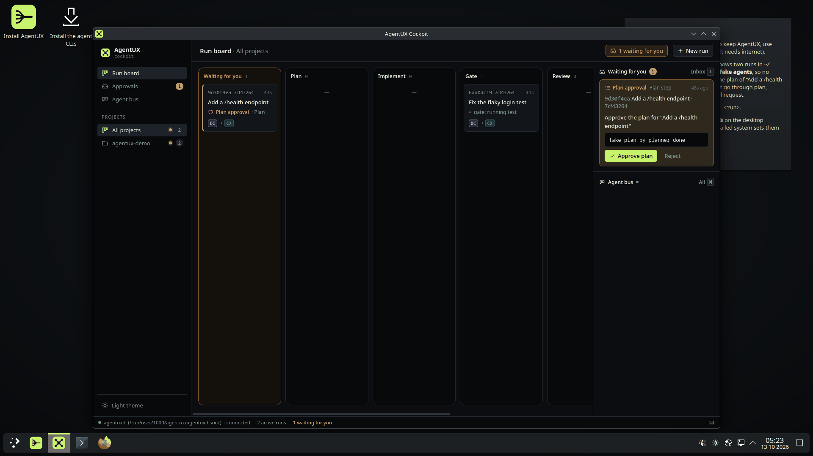
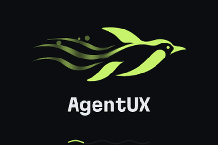
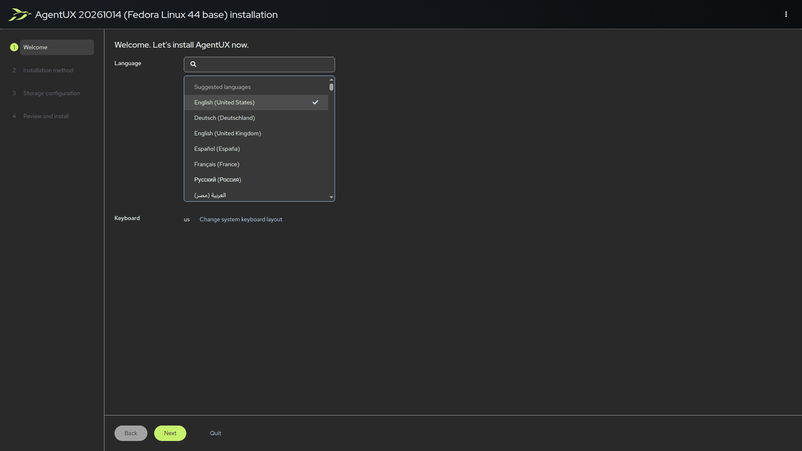
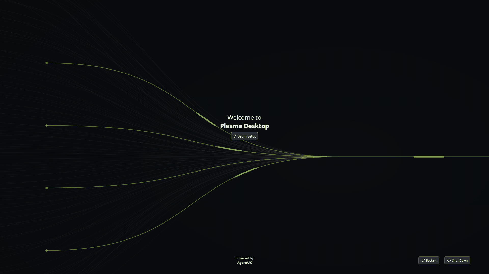

<p align="center">
  <a href="https://agentuxos.org">
    <picture>
      <source media="(prefers-color-scheme: dark)" srcset="brand/svg/lockup-dark.svg">
      
    </picture>
  </a>
</p>

<h3 align="center">The Linux distribution where every coding agent works as one team.</h3>

<p align="center">
  <a href="https://github.com/agentux-os/agentux-os/actions/workflows/build.yml"></a>
  <a href="https://github.com/agentux-os/agentux-core/releases"></a>
  <a href="https://github.com/agentux-os/agentux-desktop/releases"></a>
  <a href="docs/adr/0001-linux-distribution-on-fedora-atomic.md"></a>
  <a href="LICENSE"></a>
  <a href="https://agentuxos.org"></a>
  <a href="https://download.agentuxos.org"></a>
</p>

<p align="center">
  <a href="https://agentuxos.org"><b>Website</b></a> ·
  <a href="https://download.agentuxos.org"><b>Download</b></a> ·
  <a href="docs/"><b>Docs</b></a> ·
  <a href="docs/getting-started.md"><b>Getting started</b></a> ·
  <a href="https://github.com/agentux-os/agentux-os/releases"><b>Releases</b></a>
</p>

AgentUX is a Linux distribution for developers who use coding agents from several vendors. It ships the providers' own CLI harnesses — Claude Code, Codex, OpenCode, Antigravity CLI — already installed and wired together: one interface on top of all of them, an agent bus so they can talk to each other, and an orchestrator that takes work from issue to reviewed pull request.

> **Status:** pre-release (agentux-core 0.4.2 and agentux-desktop 0.4.5, in the daily images; the first image release, v0.5.x, is being published now). A bootable, signed image exists for x86_64 and aarch64, in two variants (KDE Plasma and Hyprland), with `agentuxd`, `aux`, the cockpit and every vendor CLI installed. Runs go from prompt to pull request through real harness sessions over ACP, agents talk over the agent bus, any session opens in its vendor's TUI, and gate checks can run in rootless Podman.
>
> Verified in CI: both variants build and pass a first-login smoke test on amd64 and arm64; the Plasma image boots nightly under QEMU/KVM on x86_64 and takes a fake-agent run to a pull request; image signatures are checked against the policy installed systems enforce.
>
> Not verified yet: full cross-vendor runs with real Claude Code, Codex and Antigravity sessions (OpenCode has been tried); booting the arm64 image on real hardware or a VM; booting the Hyprland image (its config is checked, not run). Decisions are recorded in [`docs/adr/`](docs/adr/).



| Boot | Installer | First boot |
|---|---|---|
| [](docs/screenshots/boot-animation.gif) | [](docs/screenshots/installer.png) | [](docs/screenshots/first-boot.png) |

The screenshots are captured by CI: the live ISO and installer tests boot the real images in QEMU (demo runs use fake agents). The boot animation is rendered from the Plymouth theme; the login splash plays the same scene.

## Start here

This repository is the project's front door: the specification, the roadmap, the design decisions and the brand. Where to go next:

| I want to… | Go to |
|---|---|
| See what AgentUX is | [agentuxos.org](https://agentuxos.org), then [Why](#why) and [How it works](#how-it-works) below |
| Try it without installing | The live ISO: [agentux-live-x86_64.iso](https://download.agentuxos.org/iso/stable/agentux-live-x86_64.iso) ([how](https://github.com/agentux-os/agentux-os#try-it-live)) |
| Install it | [Try it](#try-it) below, or [Install](https://github.com/agentux-os/agentux-os#install) in agentux-os; every download is on [download.agentuxos.org](https://download.agentuxos.org) |
| Get going after the first login | [Getting started](docs/getting-started.md) |
| Run agents from the terminal | [`aux` and `agentuxd`](https://github.com/agentux-os/agentux-core#at-a-glance) in agentux-core |
| Work on the cockpit or the desktop | [agentux-desktop](https://github.com/agentux-os/agentux-desktop#at-a-glance) |
| Understand a design decision | [Architecture decision records](docs/adr/) |
| Use the logo or colours | [Brand](brand/) |
| See what is done and what is next | [Roadmap](#roadmap) |

**Contents:** [Try it](#try-it) · [Why](#why) · [How it works](#how-it-works) · [Architecture](#architecture) · [Repositories](#repositories) · [Roadmap](#roadmap) · [License](#license)

## Try it

There are two images, built from the same `Containerfile` ([ADR 0010](docs/adr/0010-image-variants-and-system-identity.md)):

| Image | Desktop |
|---|---|
| `ghcr.io/agentux-os/agentux` | KDE Plasma with the AgentUX defaults (the default) |
| `ghcr.io/agentux-os/agentux-hyprland` | The same system plus a tiling Hyprland session, preselected at login; Plasma stays selectable |

To look around without installing, boot the **live ISO**: the real desktop with a demo of fake agents, and an *Install AgentUX* launcher that installs the signed image from the registry ([Try it live](https://github.com/agentux-os/agentux-os#try-it-live)).

Install from the ISO, or switch an existing Fedora Atomic / bootc system to either image:

```sh
sudo bootc switch ghcr.io/agentux-os/agentux:latest            # Plasma
sudo bootc switch ghcr.io/agentux-os/agentux-hyprland:latest   # Hyprland
systemctl reboot
```

Both images are multi-arch: the same command works on x86_64 and on 64-bit ARM UEFI machines (SystemReady hardware, VMs on Apple silicon or Ampere hosts), and the ISO comes as `x86_64` and `aarch64`. The arm64 image is built and smoke-tested but has not been booted yet; boards that need their own firmware or kernel are not covered.

Every published image is signed with cosign (keyless and with the AgentUX key), and installed systems refuse unsigned updates; to check a signature yourself, see [Verifying the image](https://github.com/agentux-os/agentux-os#verifying-the-image).

Details, the ISO download and rollback are in the [agentux-os README](https://github.com/agentux-os/agentux-os#install). After the first login, follow [Getting started](docs/getting-started.md): choose a variant, log in to the vendor CLIs, take the cockpit tour and start a first run.

## Why

Running several agents in parallel worktrees is already solved by many tools. What is missing:

- **One interface for every vendor.** Sessions, diffs and permission requests from any harness look the same and land in one approval inbox. The original TUI is always one click away.
- **Agents that talk to each other.** An implementer can ask a reviewer from another vendor to check its diff, hand off a task, or escalate a decision to you — all through a mediated, auditable bus.
- **Workflows as code.** The pipeline (plan → implement → test → review → PR) is declared in the repository and versioned with it.
- **A system agents cannot break.** Immutable, image-based OS with one-step rollback; every task runs in its own git worktree.

## How it works

1. You hand AgentUX an issue (or a prompt) from the cockpit or the `aux` CLI.
2. It creates a git worktree and branch for the task.
3. An implementer harness works in that worktree; its session streams to the cockpit.
4. Tests and linters gate the result; failures loop back to the implementer, up to a limit.
5. A reviewer harness from a different vendor reviews the diff, talking to the implementer over the agent bus when needed.
6. AgentUX opens the pull request and asks you only for the decisions that are yours.

Inference stays with the providers, using your own logins and API keys. No GPU required.

## Architecture

| Layer | What it is |
|---|---|
| OS | Fedora Atomic (Kinoite) built with bootc, x86_64 and aarch64; KDE Plasma (Wayland), or Hyprland in the second image; immutable with atomic rollback, signed images |
| Harnesses | Each provider's CLI, driven through the Agent Client Protocol (ACP) or its headless mode |
| `agentuxd` | Daemon: runs, worktrees, sessions, workflow state (SQLite), agent bus (MCP) |
| Cockpit / `aux` | Unified desktop interface and its terminal twin |
| Toolchain | `git`, `gh`, `mise`, `uv`, `bun`, `ripgrep`, `fd`, `ast-grep`, `delta`, `lazygit`, `just`, Podman |

## Repositories

| Repo | Contents |
|---|---|
| [agentux](https://github.com/agentux-os/agentux) | Specification, roadmap, ADRs |
| [agentux-core](https://github.com/agentux-os/agentux-core) | `agentuxd`, `aux` CLI, workflow engine, harness adapters, agent bus |
| [agentux-desktop](https://github.com/agentux-os/agentux-desktop) | Cockpit app and desktop configuration |
| [agentux-os](https://github.com/agentux-os/agentux-os) | `Containerfile` for both image variants, image CI, signing, boot splash and ISO builds |

## Roadmap

Done:

- [x] **Core MVP:** `aux run` drives a planner, an implementer and a cross-vendor reviewer through gates to an open PR, as a persisted state machine in its own worktree ([agentux-core](https://github.com/agentux-os/agentux-core)).
- [x] **Agent bus:** agents message each other, request reviews, hand off and escalate to you; you can post on the bus and talk to a live session.
- [x] **Cockpit:** run board, unified session view, approvals inbox, agent bus feed and spend, on the real daemon ([agentux-desktop](https://github.com/agentux-os/agentux-desktop)).
- [x] **First image:** bootable AgentUX image and ISO with harnesses, toolchain, daemon, cockpit and Plasma defaults; pinned component releases, nightly image and boot test ([agentux-os](https://github.com/agentux-os/agentux-os), [ADR 0008](docs/adr/0008-releases-and-image-pinning.md)).
- [x] **Terminal mode:** any session opens in its vendor's TUI on the same conversation, from the cockpit or `aux attach` ([ADR 0007](docs/adr/0007-terminal-mode-is-a-session-handoff.md)).
- [x] **Container-isolated checks:** gate checks run in rootless Podman, opt-in per project, with per-check timeouts ([ADR 0009](docs/adr/0009-container-isolation-for-checks.md), [agentux-core#13](https://github.com/agentux-os/agentux-core/pull/13)).
- [x] **Hyprland variant:** `ghcr.io/agentux-os/agentux-hyprland`, a tiling session laid out for watching several agents ([ADR 0010](docs/adr/0010-image-variants-and-system-identity.md), [agentux-os#15](https://github.com/agentux-os/agentux-os/pull/15)).
- [x] **Signed images:** keyless and key-based cosign signatures on every published image, enforced by the container policy on installed systems ([agentux-os#9](https://github.com/agentux-os/agentux-os/pull/9)).
- [x] **`aarch64`:** RPMs for both components, a multi-arch image and an aarch64 ISO ([agentux-os#12](https://github.com/agentux-os/agentux-os/pull/12)).
- [x] **System identity:** the system calls itself AgentUX (os-release, KDE About) and boots with an AgentUX Plymouth splash ([ADR 0010](docs/adr/0010-image-variants-and-system-identity.md)).

Next:

- [ ] End-to-end validation with real harnesses: Claude Code, Codex and Antigravity sessions driven through a full run (OpenCode has been tried).
- [ ] Isolating agents' own tool calls, not only gate checks (needs its own ADR: the harness runs tools in a container while its login stays outside).
- [ ] Signed RPMs (the images are signed; the component RPMs they install are not).
- [ ] Boot test on arm64: the arm64 image has never been booted, since CI's arm64 runners lack KVM.
- [ ] Boot test for the Hyprland image (today only its configuration is checked).
- [ ] Agent status in Hyprland: runs and pending approvals from `agentuxd` in Waybar (today its AgentUX module only opens the cockpit) and as mako notifications.

## License

[Apache 2.0](LICENSE)
