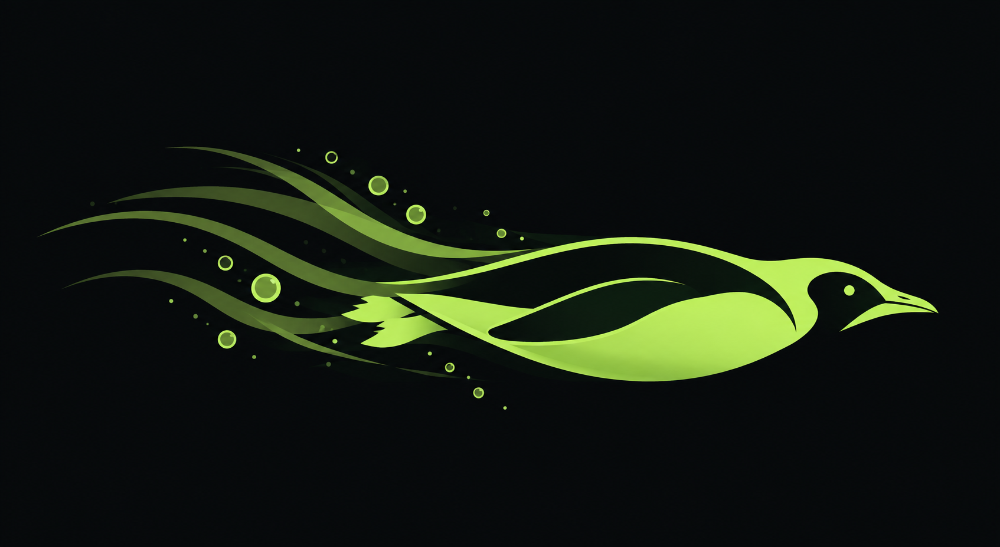

# Review: the swimming-penguin proposal (November 2026)

**Proposal:** a glowing lime penguin swimming right. It has a dark back and face, translucent gradient trails and glowing bubbles, about 1.8:1 overall. The source is `.github/profile/assets/logo.png`.

**Compared with:** the current mark, [`src/penguin.svg`](../src/penguin.svg), and the assets built from it.

**Verdict:** adopt with changes. The new anatomy should go into the current flat system, not replace it. Until the redrawn flat mark exists, the current mark stays for every mark, icon and lockup use.

## What it gets right

It reads as a penguin much faster than the current mark. The dark head with an eye and the torpedo body say "penguin swimming". In the current mark, the raised top flipper reads as a wing in flight, closer to a swallow or a dove.

## What needs fixing

**Anatomy**
- The beak is long, thin and open. It reads as a heron or a loon, not a penguin.
- The body is about 3:1. With the trails behind it, it drifts towards a fish, an eel or a dolphin.
- The back and face are cut-outs (background colour) inside a lime outline. The penguin looks hollow, not black-and-white, and the flipper only exists as a negative wedge.
- The two jagged feet by the tail read as torn paper, flame or a fish's fin. This is the weakest detail.

**Scale**
- At 16 to 32 px it becomes a horizontal lime sliver. The eye and the mask disappear, and the trails and bubbles turn into noise.
- In a square app icon (48 to 256 px), the 3:1 body fills about a third of the height. It is weaker than the compact mark, whose flipper gives it vertical mass.
- A single-colour version has nothing for the translucency or the glow. Only the silhouette is left.
- On a light background it breaks. Because the back and face are cut-outs, they turn white, so the black-and-white identity inverts, and lime on white has about 1.3:1 contrast.

**Production**
- The body, head, eye and beak can be redrawn as 6 to 8 flat shapes.
- The gradient trails, the glowing bubbles with highlights and the soft raster edges can't be.
- The style breaks this guide's own rule: no glow, and no gradient except the wake.

**Distinctiveness**
- The speed comes across, but a torpedo penguin with a neon trail is close to stock, energy-drink and gaming art.
- The trails can read as a comet, an aurora or a flame.
- It does not resemble Tux, which is good.
- The multi-line wake is the only "agentic" cue, and the current mark already has it.

**Composition**
- As a horizontal lockup it works, but the mark has to be more than 1.9× the cap height of the wordmark or it becomes a line.
- A square icon needs a shorter body or a slight diagonal dive. The dive would mean revisiting the "never rotate" rule.

## Changes, in priority order

1. **Invert the colour logic.** Draw the back and face mask as solid Ink shapes, not cut-outs, with a Lime belly, and remove the lime outline on the back. This fixes light backgrounds and single-colour use.
2. **Replace the jagged feet** with two smooth wedges, or drop them.
3. **Shorten the body** to about 2.3:1, with a shorter, thicker beak.
4. **Flatten everything.** Use three flat trail lines at 42 % and solid dots for bubbles. No glow and no gradient, except the wake-to-back gradient the guide already allows.
5. **Make a compact mark** of just the head and body, checked at 16 px. The eye may drop out below 24 px.
6. **Make the Moss/Ink version** for light backgrounds before approving anything.

## How to use it meanwhile

| Version | Where |
|---|---|
| The glowing proposal, as it is | Hero art only: the org README, wallpaper, social posts, splash art |
| The current flat mark | Mark, app icons, favicon, lockups, until the redrawn version replaces it |
| The redrawn flat version (to do) | Rebuilt through `src/penguin.svg` and `src/build.py` like every other asset, then it replaces the current mark everywhere |
